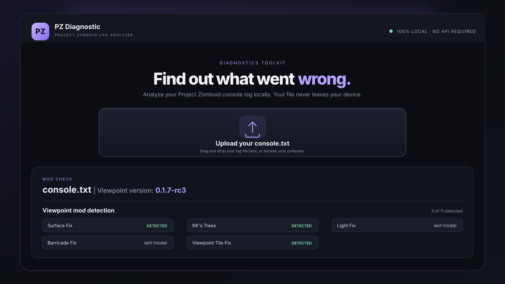

# PZ Diagnostic

check this list and unsubscribe from the Workshop and RESTART your game.. usually fixes crash-mod related..
if keeps crashing; disable every addons that are not models like devs recommended in #🌙nightly-releases section.

(broken mods with nightly version)
1. Surface fix - https://steamcommunity.com/sharedfiles/filedetails/?id=3814398576

2. Visceral - https://steamcommunity.com/workshop/filedetails/?id=3820965001

3. KK's Shelves - https://steamcommunity.com/sharedfiles/filedetails/?id=3815931973

4. KK's TREE in 3D - https://steamcommunity.com/sharedfiles/filedetails/?id=3813172420

5. Door Fix - https://steamcommunity.com/workshop/filedetails/?id=3812151347

6. Immersive Snow - Viewpoint https://steamcommunity.com/sharedfiles/filedetails/?id=3816586790

7. Mvdox Grass - https://steamcommunity.com/sharedfiles/filedetails/?id=3815166404

8. Viewpoint Tile Fix - https://steamcommunity.com/sharedfiles/filedetails/?id=3814178814

9. Barricade Fix - https://steamcommunity.com/sharedfiles/filedetails/?id=3815033191

10. Light Fix - https://steamcommunity.com/sharedfiles/filedetails/?id=3811344119

11. Viewpoint Better Terrain - https://steamcommunity.com/sharedfiles/filedetails/?id=3815223174
